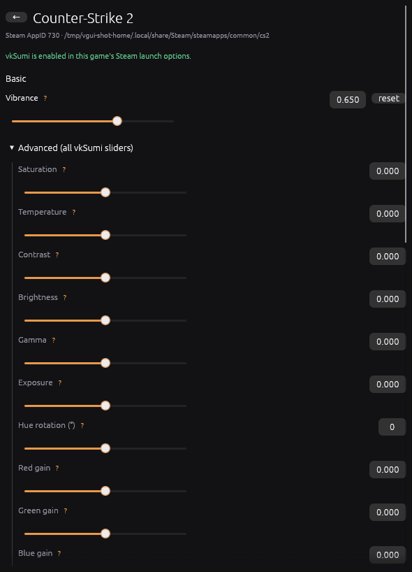
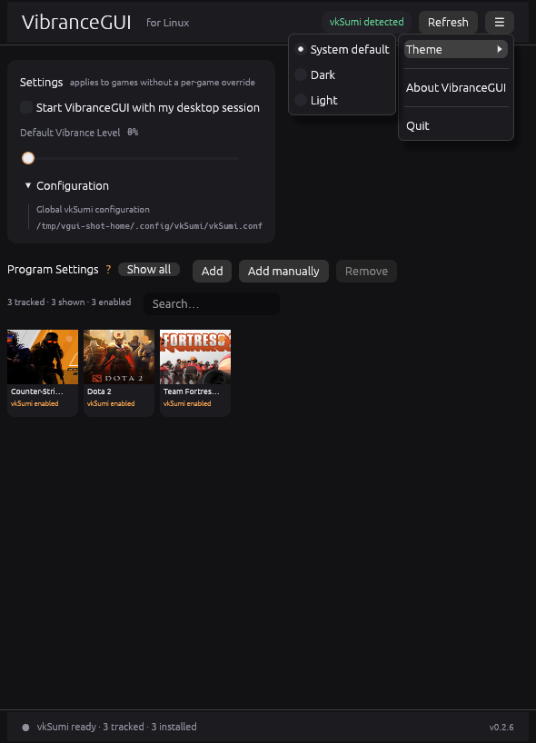

# VibranceGUI for Linux

<p align="center">
  <a href="https://github.com/NasirA1991/vibrancegui-linux/releases/latest"></a>
  <a href="https://aur.archlinux.org/packages/vibrancegui-linux"></a>
  <a href="LICENSE"></a>
</p>

**An unofficial Linux profile manager for [vkSumi](https://github.com/reakjra/vkSumi), inspired by the Windows [VibranceGUI](https://vibrancegui.com/).**

VibranceGUI for Linux gives vkSumi a desktop home. It discovers your Steam games, finds the vkSumi profile that affects each one, and lets you adjust that profile from a compact game library instead of editing files by hand. Changes are written to vkSumi's configuration and picked up while the game is running.

vkSumi is the part that actually changes colours. It is a separate Vulkan layer that must be installed and loaded by the game. This project does not bundle it, install it, or pretend to be it. The app can run without vkSumi and still browse games and edit known profiles; colour adjustment only works when vkSumi is present and loaded.

> **Unofficial project.** Not affiliated with, endorsed by, or sponsored by the Windows VibranceGUI project or by vkSumi.

<p align="center">
  <a href="docs/images/main-window.png"></a>
</p>
<p align="center"><sub>The main window: game library, global vibrance and desktop settings.</sub></p>

## Screenshots

The game settings window keeps **Vibrance** in Basic and puts the remaining vkSumi controls under **Advanced**. The application menu holds theme selection, About and Quit; the main settings panel holds autostart and the global config path.

| Game settings | Settings and app menu |
|:---:|:---:|
| [](docs/images/game-settings.png) | [](docs/images/settings-menu.png) |
| Basic and Advanced colour controls | Autostart, configuration path, theme and application controls |

These are screenshots of the real application, captured with an isolated demo Steam library. No personal Steam account or game library is shown.

## What works

### Steam integration and game discovery

- Scans native Steam libraries, app manifests, launch options and Steam shortcuts.
- Shows the installed Steam library with cached artwork and extracts icons for manual non-Steam games.
- Detects games that are configured for vkSumi, even when they are not currently running.
- Observes running game processes and checks whether `libVkLayer_vksumi.so` is actually mapped.
- Adds non-Steam games manually, or adopts them automatically after they run with vkSumi enabled.

### Global and per-game profiles

- Edits the effective vkSumi profile for the selected game.
- Provides a global **Default Vibrance Level** for games without an override.
- Resolves explicit `VKSUMI_CONFIG_FILE` paths, remembered paths and vkSumi's per-executable profile paths.
- Supports live editing while the game is running; vkSumi hot-reloads the file.
- Writes atomically, keeps timestamped backups, and resets individual controls or all managed overrides.

### Colour controls

- **Basic:** vibrance.
- **Advanced:** saturation, temperature, contrast, brightness, gamma, exposure, hue rotation, RGB gains, shadows/midtones/highlights, six hue bands, split toning, vignette, and daltonize strength/severity.
- 27 numeric controls in total, with typed or dragged values, help tooltips and per-control reset.
- The censor-box editor and daltonize-mode selector are **not** exposed; they remain config-file-only.

The complete control reference is in [docs/CONFIGURATION.md](docs/CONFIGURATION.md#numeric-controls).

### Interface and desktop integration

- Compact VibranceGUI-style game grid with search, **Show all**, **Add**, **Add manually** and **Remove**.
- Separate native game settings window, so the library stays open.
- System, dark and light themes.
- StatusNotifierItem tray with **Show**, **Refresh Steam library** and **Quit**; close-to-tray where the desktop supports it.
- Optional XDG autostart that starts a tray-only helper.
- Standalone `--doctor` and `--doctor --observe` diagnostics.

### Safety and data integrity

- Steam files are read-only. The app never edits Steam configuration or launch options.
- Profile writes are limited to the vkSumi configuration directory. External profiles are displayed read-only.
- No root access, package-manager calls, background service or telemetry.
- Process observation reads only the vkSumi/Steam variables it needs; unrelated environment variables are not logged or stored.

## Requirements

### To run the application

- Linux with Wayland or X11.
- No vkSumi installation is required just to open the app, scan Steam, or edit an already-resolved profile.
- A StatusNotifierItem host for the tray. KDE Plasma works out of the box; GNOME needs an AppIndicator/StatusNotifier extension.
- `xdg-desktop-portal` for the native file picker used by **Add manually**.

### To adjust a game's colours

- [vkSumi](https://github.com/reakjra/vkSumi) installed separately and visible to the game. The AUR packages list `vksumi` as an optional dependency; this project never installs or bundles it.
- A Vulkan game. OpenGL games are not covered by vkSumi.
- `ENABLE_VKSUMI=1` in the game's Steam launch options, before `%command%`.

### To build from source

- Rust 1.95 or newer (edition 2024).
- Native GL/EGL, X11/Wayland, fontconfig, OpenSSL and `pkg-config` development packages. Exact package names are in the [development guide](docs/DEVELOPMENT.md#build).

## VibranceGUI and vkSumi

The responsibilities are deliberately separate:

| Component | Responsibility |
| --- | --- |
| **VibranceGUI for Linux** | Discovers games, resolves profile paths, provides the UI, and edits vkSumi configuration files. |
| **vkSumi** | A Vulkan implicit layer that reads the profile and performs the actual colour processing in the game. |
| **Steam** | Launches the game with the environment that tells vkSumi to load. |

What follows from that split:

- The app can start, scan Steam and inspect launch options without vkSumi.
- The app can edit a profile without vkSumi, but the game will not be graded until the layer is installed and loaded.
- vkSumi must be enabled **before** the game creates its Vulkan instance. The app cannot switch it on inside a running game.
- The app does not download, install or update vkSumi. Install it with your distribution's package manager or from the upstream project, and reuse an existing installation.
- Avoid installing a second copy of the layer alongside an existing system package; duplicate or conflicting layer manifests are a common cause of load failures.

For Arch Linux and CachyOS, the upstream package is:

```bash
paru -S vksumi
```

## Install

### Arch Linux and CachyOS (AUR)

Prebuilt package — no Rust compilation on your machine:

```bash
paru -S vibrancegui-linux-bin
```

Source package, built locally by your AUR helper:

```bash
paru -S vibrancegui-linux
```

Both packages install the same `vibrancegui` binary and conflict with each other. Install one, not both. If an AUR helper cannot find a package immediately after a release, refresh its databases first.

### AppImage

Download `vibrancegui-linux-<version>-x86_64.AppImage` from the [latest release](https://github.com/NasirA1991/vibrancegui-linux/releases/latest), then:

```bash
chmod +x vibrancegui-linux-*.AppImage
./vibrancegui-linux-*.AppImage
```

The AppImage is x86_64 and uses the host's OpenGL/EGL, Wayland/X11, font, OpenSSL and desktop-portal libraries. It does not bundle a Vulkan driver, vkSumi or a portal backend. Replace `vibrancegui` with `./vibrancegui-linux-*.AppImage` in command examples when you use the AppImage.

The release page also provides a prebuilt native binary and `SHA256SUMS`. Both the GUI and the CLI diagnostics are in the same binary.

### Build from source

```bash
cargo build --release --locked
./target/release/vibrancegui
```

See the [development guide](docs/DEVELOPMENT.md) for dependencies, tests and packaging.

## Getting started

1. **Install VibranceGUI for Linux.** Use one of the methods above.
2. **Install vkSumi** if it is not already present, and make sure it is visible to the game.
3. **Enable vkSumi for the game.** In Steam, open the game's **Properties → Launch Options** and add:

   ```text
   ENABLE_VKSUMI=1 %command%
   ```

   If the game already uses wrappers, keep the variable at the front:

   ```text
   ENABLE_VKSUMI=1 mangohud gamemoderun %command%
   ```

4. **Start VibranceGUI for Linux** and keep it running.
5. **Launch the game**, then wait a few seconds for process detection and layer verification.
6. **Select the game tile.** Its settings window shows the effective profile and the colour controls.
7. **Adjust Vibrance or Advanced controls.** Values are written to vkSumi's profile and hot-reloaded by the game.

If the game is not in the grid, enable **Show all** or use **Add**. Running the game once while the app is open links its profile for later editing.

The full first-run walkthrough, including non-Steam games and troubleshooting, is in [Getting Started](docs/GETTING_STARTED.md).

## Discovery, profiles and status

These states are independent. A game can be installed without being enabled, enabled without the app tracking it, tracked without running, or running without vkSumi having loaded successfully.

| State | What it means |
| --- | --- |
| **Installed** | Steam's manifest for the game was found in a library. |
| **Enabled for vkSumi** | The launch options contain `ENABLE_VKSUMI=1`. |
| **Tracked** | The game is in the app's grid, either automatically or through **Add**. |
| **Running** | A matching process was observed in `/proc`. |
| **Layer mapped** | `libVkLayer_vksumi.so` is visible in that process's memory maps. |
| **Profile linked** | An effective vkSumi configuration path was resolved. |

A running process does not prove that vkSumi loaded; check for **Detected · vkSumi layer mapped**. The app shows **Detected · layer unconfirmed** when the process is running but the library is not visible in its maps, or the maps could not be read.

Native Steam libraries and shortcuts are scanned; Heroic, Lutris, Bottles, Faugus and Flatpak libraries are **not imported**. Their running games can be auto-adopted after they run with vkSumi enabled, or added manually. See [Adding games](docs/USAGE.md#adding-games).

### Where settings live

| File or variable | Purpose |
| --- | --- |
| `~/.config/vkSumi/vkSumi.conf` | Global vkSumi defaults. The main slider writes only `vibrance` here. |
| `~/.config/vkSumi/games/<executable-stem>.conf` | Normal per-executable vkSumi profile. |
| `VKSUMI_CONFIG_FILE` | Explicit profile path from Steam launch options or a running process. |
| `~/.config/vibrancegui/state.json` | Tracked games, remembered profile paths and theme. |
| `~/.config/vibrancegui/backups/` | Timestamped profile backups (up to 20). |
| `~/.cache/vibrancegui/artwork/` | Downloaded Steam artwork. |
| `~/.cache/vibrancegui/icons/` | Icons extracted from Windows executables. |

Paths are XDG-aware; `XDG_CONFIG_HOME` and `XDG_CACHE_HOME` override the defaults. See [Configuration](docs/CONFIGURATION.md#file-locations) for the full table and profile-resolution order.

## How it works

The app reads native Steam metadata without modifying it, observes `/proc` while it is running, resolves the effective profile, and writes changes with a temporary file and atomic rename. It does not inject code into the game; vkSumi watches the profile and reloads it. Steam launch options stay manual.

## Current limitations

- **No Steam launch-option editing.** The `ENABLE_VKSUMI=1` line is still added once in Steam. Managed VDF writing is planned.
- **No one-click Enable/Disable.** Remove `ENABLE_VKSUMI=1` from the launch options, or set `DISABLE_VKSUMI=1` for that game.
- **No Heroic/Lutris/Bottles/Faugus import, and no Flatpak Steam library import.** Such games can be auto-adopted once they run with vkSumi enabled, or added manually.
- **No censor-box editor and no daltonize-mode selector.** Those remain config-file-only; the numeric daltonize controls are exposed.
- **Vulkan only.** OpenGL games do not work, and anti-cheat software may block Vulkan layers.
- **Per-executable profile collision.** vkSumi keys default profiles by executable name. Two games with the same executable need distinct `VKSUMI_CONFIG_FILE` values.
- **Observation requires the app to be running.** It installs no service and does not inject into games.
- **No Flatpak package.** The AppImage is the portable option; tray and portal behavior depend on the desktop.
- **Tray availability varies.** Without a StatusNotifierItem host the window uses normal close behavior and no tray icon appears.

Planned work is listed in the [roadmap](docs/DEVELOPMENT.md#roadmap). Features in this README are implemented in the latest release unless explicitly marked as planned.

## Troubleshooting

| Symptom | First thing to check |
| --- | --- |
| Header says **vkSumi not detected** | Install vkSumi, confirm the layer is visible to the game, then press **Refresh**; run `vibrancegui --doctor`. |
| A game is missing from the grid | Press **Show all**; confirm the exact `ENABLE_VKSUMI=1` token in Steam launch options; press **Refresh**. |
| Game is detected but colours do not change | Check for **Detected · vkSumi layer mapped**, then check `DISABLE_VKSUMI=1`, `enabled = false`, the selected profile, and whether the game is Vulkan. |
| Close button does not hide the window | Install a StatusNotifierItem host, or start with `--no-tray` to use normal close behavior. |
| Profile is visible but controls are read-only | The profile path is outside the vkSumi config directory. See [external profiles](docs/CONFIGURATION.md#external-profiles). |

See [Troubleshooting](docs/TROUBLESHOOTING.md) for detailed fixes, including AUR build errors, AppImage startup issues and tray problems.

## Documentation

| Document | Contents |
| --- | --- |
| [Getting Started](docs/GETTING_STARTED.md) | Install vkSumi, enable a game and complete the first profile edit |
| [User guide](docs/USAGE.md) | Main window, adding games, discovery states, profiles, tray, autostart, CLI flags |
| [Configuration](docs/CONFIGURATION.md) | Profile resolution, all 27 controls, file format, backups, state and cache paths |
| [Troubleshooting](docs/TROUBLESHOOTING.md) | Layer, detection, rendering, packaging, tray and permissions problems |
| [Development](docs/DEVELOPMENT.md) | Build dependencies, architecture, tests, release and AUR workflow, roadmap |
| [Contributing](CONTRIBUTING.md) | Bug reports, pull requests and review expectations |
| [Security](SECURITY.md) | Security model, data handling and reporting |

## Contributing and support

- Report bugs and request features in [GitHub Issues](https://github.com/NasirA1991/vibrancegui-linux/issues).
- Include the app version, distribution and desktop, and the relevant `vibrancegui --doctor` output. Redact your Steam account ID, game list and personal paths before posting.
- Read [CONTRIBUTING.md](CONTRIBUTING.md) before opening a pull request.

## License and naming

MIT. See [LICENSE](LICENSE).

This is an unofficial community project. “VibranceGUI” is used descriptively for the interaction model; the project is not affiliated with, endorsed by, or sponsored by the Windows VibranceGUI project. vkSumi is a separate MIT project and is not bundled.
