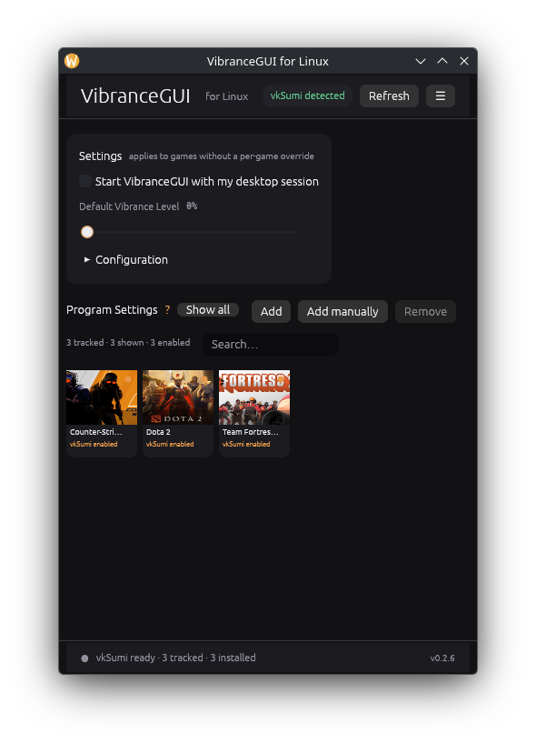

# VibranceGUI for Linux

<p align="center">
  
</p>

**Unofficial.** A lightweight, native Linux companion for [vkSumi](https://github.com/reakjra/vkSumi), inspired by the Windows [VibranceGUI](https://vibrancegui.com/). Not affiliated with the Windows project.

**VibranceGUI for Linux is a vkSumi profile manager.** It discovers installed and running games, links each game to its effective vkSumi profile, and lets you tune the profile while the game is running. It is not a Vulkan layer, a game launcher, or an overlay, and it does **not** edit Steam launch options or Steam's configuration files.

[Source](https://github.com/NasirA1991/vibrancegui-linux) · [AUR source package](https://aur.archlinux.org/packages/vibrancegui-linux) · [AUR prebuilt package](https://aur.archlinux.org/packages/vibrancegui-linux-bin) · [Latest release](https://github.com/NasirA1991/vibrancegui-linux/releases/latest)

## Features

### Profile management

- Edits the effective vkSumi profile in place; vkSumi hot-reloads changes while the game runs.
- Exposes 27 numeric vkSumi controls: vibrance, saturation, temperature, contrast, brightness, gamma, exposure, hue rotation, RGB gains, shadows/midtones/highlights, six hue bands, split-toning strength and hue, vignette, and daltonize strength/severity.
- Values can be typed or dragged. Each control has a **?** explanation and a **reset** action that removes the override so the profile inherits the global value.
- **Reset overrides** removes every control the editor manages from that profile.
- Writes atomically and keeps timestamped backups (up to 20 per backup directory).

### Game discovery

- Scans native Steam libraries, app manifests, launch options, and Steam shortcuts.
- Shows enabled games by default. A normal Steam game is visible when its launch options contain `ENABLE_VKSUMI=1`, or when it is running with vkSumi enabled. **Show all** reveals the rest of the installed library; **Add** can track any installed game regardless of its launch options; it opens the game for editing immediately.
- Detects running games from `/proc` and checks `/proc/<pid>/maps` for `libVkLayer_vksumi.so`, so “running” is distinguishable from “vkSumi loaded”.
- Resolves the effective profile from the game's launch-option or process `VKSUMI_CONFIG_FILE` when present, otherwise from vkSumi's per-executable profile path.
- Discovered non-Steam games are adopted automatically. Games that are not running yet can be added manually with an executable, icon, and optional profile path.
- Loads Steam artwork, extracts Windows `.exe` icons, and caches both locally.

### Desktop integration

- Compact VibranceGUI-style main window with a game grid and a separate native game settings window.
- StatusNotifierItem tray with **Show**, **Refresh Steam library**, and **Quit**. Closing hides to the tray when a tray host is available.
- Optional autostart entry that starts a tray-only helper.
- System, dark, and light themes; the choice is saved.
- About dialog and direct issue/repository links.

### Safety

- Steam files are read-only. The app never writes Steam configuration or launch options.
- Game config writes are limited to profiles inside the vkSumi config directory. Profiles outside it are shown read-only.
- Besides profiles, the app writes its own state, backups, artwork/icon caches, and an optional autostart entry.
- No root access, package-manager calls, or system service.
- Process observation reads only the vkSumi/Steam variables it needs; unrelated environment variables are not logged or stored.

## Requirements

### Runtime

- Linux with Wayland or X11.
- A Vulkan-capable game. OpenGL games are not supported by vkSumi.
- [vkSumi](https://github.com/reakjra/vkSumi) installed separately and visible to the game. The AUR packages list `vksumi` as an optional dependency; VibranceGUI never installs or bundles it.
- A StatusNotifierItem host for the tray. KDE Plasma works out of the box; GNOME requires an AppIndicator/StatusNotifier extension.
- For **Add manually**, a desktop portal implementation (`xdg-desktop-portal`) for the native file picker.

### Building from source

- Rust 1.95 or newer (edition 2024).
- Native GL/EGL, X11/Wayland, fontconfig, OpenSSL, and `pkg-config` development packages. Exact package names are in the [development guide](docs/DEVELOPMENT.md#build).

## Install

### Arch Linux and CachyOS (AUR)

Prebuilt package — no Rust compilation on your machine:

```bash
paru -S vibrancegui-linux-bin
```

Source package, built locally by your AUR helper:

```bash
paru -S vibrancegui-linux
```

The two packages provide the same `vibrancegui` binary and conflict with each other. Do not install both. If an AUR helper cannot find a package immediately after a release, refresh its databases first.

### AppImage

Download `vibrancegui-linux-<version>-x86_64.AppImage` from the [latest release](https://github.com/NasirA1991/vibrancegui-linux/releases/latest), then:

```bash
chmod +x vibrancegui-linux-*.AppImage
./vibrancegui-linux-*.AppImage
```

The AppImage uses the host's OpenGL/EGL, Wayland/X11, font, OpenSSL, and desktop-portal libraries. It does not bundle a Vulkan driver or vkSumi.

### Build from source

```bash
cargo build --release --locked
./target/release/vibrancegui
```

The release page also provides a prebuilt native binary and `SHA256SUMS`. See the [development guide](docs/DEVELOPMENT.md) for build dependencies and project structure.

## Quick start

1. Install vkSumi if it is not already present. The app shows an install hint when the layer cannot be found.
2. In Steam, open the game's **Properties → Launch Options** and add:

   ```text
   ENABLE_VKSUMI=1 %command%
   ```

   If existing wrappers are already present, put the variable first:

   ```text
   ENABLE_VKSUMI=1 mangohud gamemoderun %command%
   ```

3. Start VibranceGUI for Linux and keep it running.
4. Launch the game. Within a few seconds its tile should show **running**.
5. Select the tile, then adjust **Vibrance** or open **Advanced (all vkSumi sliders)**.

If the game does not appear, enable **Show all** or use **Add**. Running the game once while the app is open links its profile for later editing.

The complete walkthrough, including non-Steam games and tray behavior, is in the [user guide](docs/USAGE.md).

## How it works

1. **Steam discovery.** Reads native Steam roots, `libraryfolders.vdf`, app manifests, `localconfig.vdf`, and `shortcuts.vdf`. All reads are read-only.
2. **Process observation.** While the app is running, scans `/proc` roughly every two seconds for processes launched with `ENABLE_VKSUMI=1`. It confirms the layer with `/proc/<pid>/maps`.
3. **Profile resolution.** Uses the process's `VKSUMI_CONFIG_FILE` when set; otherwise uses vkSumi's `games/<executable-stem>.conf` path. A linked path is remembered in the app state.
4. **Editing.** Writes the profile with a temporary file and rename, creating a timestamped backup first. vkSumi picks up the change; the app does not inject code into the game.

Steam launch options stay manual in this release. See [Configuration](docs/CONFIGURATION.md) for path precedence, every exposed control, and the exact files the app writes.

## Current limitations

- **No Steam launch-option editing.** The `ENABLE_VKSUMI=1` line is still added once in Steam. Managed VDF writing is planned for a later release.
- **No one-click Enable/Disable.** Remove `ENABLE_VKSUMI=1` from the launch options to stop using vkSumi, or set `DISABLE_VKSUMI=1` for that game.
- **No Heroic/Lutris/Bottles/Faugus import, and no Flatpak Steam library import.** Such games can be auto-adopted once they run with vkSumi enabled, or added manually.
- **No censor-box editor and no daltonize-mode selector.** Those remain config-file-only; the numeric daltonize controls are exposed.
- **Vulkan only.** OpenGL games do not work, and anti-cheat software may block Vulkan layers.
- **Per-executable profile collision.** vkSumi keys profiles by executable name. Two games with the same executable need distinct `VKSUMI_CONFIG_FILE` values.
- **Observation requires the app to be running.** It does not install a service or inject into games.
- **No Flatpak package.** The AppImage is the portable option; tray and portal behavior depend on the desktop.
- **Tray availability varies.** Without a StatusNotifierItem host the window uses normal close behavior and no tray icon appears.

Planned work is listed in the [roadmap](docs/DEVELOPMENT.md#roadmap). Features in this README are implemented in the current 0.2.x line unless explicitly marked as planned.

## Troubleshooting

| Symptom | First thing to check |
| --- | --- |
| Header says **vkSumi not detected** | Install vkSumi, confirm the layer is visible to the game, then press **Refresh**; run `vibrancegui --doctor`. |
| A game is missing from the grid | Press **Show all**; confirm the exact `ENABLE_VKSUMI=1` token in Steam launch options; press **Refresh**. |
| Game is detected but colors do not change | Check for **Detected · vkSumi layer mapped**, then check `DISABLE_VKSUMI=1`, `enabled = false`, the selected profile, and whether the game is Vulkan. |
| Close button does not hide the window | Install a StatusNotifierItem host, or start with `--no-tray` to use normal close behavior. |
| Profile is visible but controls are read-only | The profile path is outside the vkSumi config directory. See [external profiles](docs/CONFIGURATION.md#external-profiles). |

See [Troubleshooting](docs/TROUBLESHOOTING.md) for detailed fixes, including AUR build errors, AppImage startup issues, and tray problems.

## Documentation

| Document | Contents |
| --- | --- |
| [User guide](docs/USAGE.md) | Main window, adding games, launch options, profiles, tray, autostart, CLI flags |
| [Configuration](docs/CONFIGURATION.md) | Profile resolution, all 27 controls, file format, backups, state and cache paths |
| [Troubleshooting](docs/TROUBLESHOOTING.md) | Layer, detection, rendering, packaging, tray, and permissions problems |
| [Development](docs/DEVELOPMENT.md) | Build dependencies, architecture, tests, release and AUR workflow, roadmap |
| [Contributing](CONTRIBUTING.md) | Bug reports, pull requests, review expectations |
| [Security](SECURITY.md) | Security model, data handling, and reporting |

## Contributing and support

- Report bugs and request features in [GitHub Issues](https://github.com/NasirA1991/vibrancegui-linux/issues).
- Include the app version, distribution and desktop, and the relevant `vibrancegui --doctor` output. Redact your Steam account ID, game list, and personal paths before posting.
- Read [CONTRIBUTING.md](CONTRIBUTING.md) before opening a pull request.

## License and naming

MIT. See [LICENSE](LICENSE).

This is an unofficial community project. “VibranceGUI” is used descriptively for the interaction model; the project is not affiliated with, endorsed by, or sponsored by the Windows VibranceGUI project. vkSumi is a separate MIT project and is not bundled.
